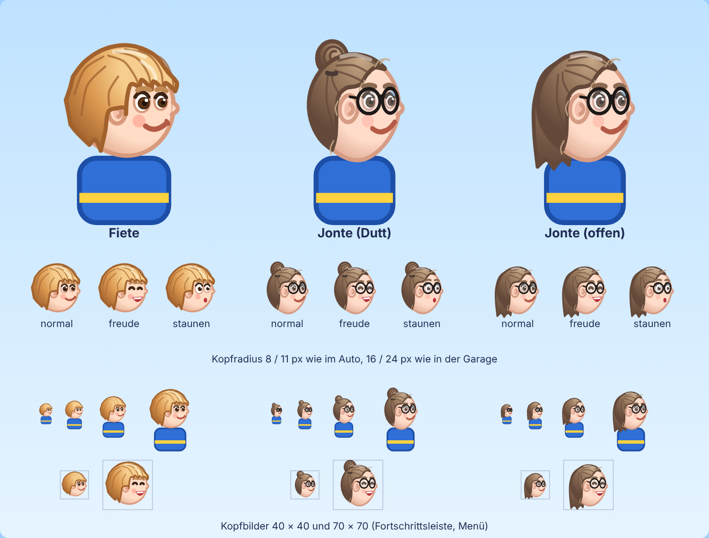

# 👦 Fiete und Jonte: so sehen sie aus

Die beiden Kinder im Spiel sind nach einem Foto der echten Fiete und Jonte
nachgebaut, damit man sie sofort erkennt: im Auto, in der Garage, in der
Spielerwahl und in der Fortschrittsleiste.



> **Stand:** Fertig gezeichnet in `kinder.js`, aber **noch nicht ins Spiel
> eingebaut**. Beim Bau lief parallel ein Umbau des übrigen Codes. Deshalb
> ändert dieser Schritt keine bestehende Datei, und es kann keine
> Merge-Konflikte geben. Wie der Einbau geht, steht in Abschnitt 3. Er wurde
> in einer Kopie des Spiels ausprobiert und funktioniert.

---

## 1. Steckbrief

| | **Fiete** | **Jonte** |
|---|---|---|
| Figur | kleiner | größer, schlanker (wie bisher: `groesse`, `breite` in `CONFIG.kinder`) |
| Haarfarbe | **rotblond**: Kupfergold, Ansatz dunkler, Spitzen heller | **hellbraun**, leicht aschig |
| Frisur | voller, weicher Schopf; **Pony seitlich in die Stirn** gekämmt, läuft vorne in Spitzen aus; Ohren halb unter den Haaren | lange Haare, **zum Dutt gebunden** (hinten oben, mit Haargummi); **Stirn frei**, feine abstehende Härchen an Schläfe, Ohr und Nacken |
| Brille | – | **runde schwarze Brille** mit kräftigem Rahmen, Bügel zum Ohr, Lichtreflex auf den Gläsern |
| Augen | braun | braun (hinter der Brille) |
| Gesicht | rund, volle Wangen, rosige Bäckchen | schmaler und länger, Kinn schmaler |
| Mund | verschmitztes Lächeln, Lippen zusammen | schiefes Lächeln, rechts höher, einen Spalt offen |
| Ohren | halb verdeckt | frei, stehen etwas ab |

**Woran man sie im Spiel erkennt.** Im Auto ist der Kopf nur etwa 8–12 px
groß. Dort zählen Umriss und Farbe:
Fiete ist der **goldene, runde Schopf**, Jonte der **braune Kopf mit Dutt
obendrauf und zwei schwarzen Brillenringen**.

**Variante für Jonte:** Mit `frisur: "lang"` hat Jonte die Haare offen bis
auf die Schultern, hinters Ohr gestrichen und ohne Pony. Die Brille bleibt.
Im Fahrtwind wehen die Haare nach hinten. Voreingestellt ist der Dutt wie auf
dem Foto.

Das Foto selbst liegt bewusst **nicht** im Repo. Alles Nötige steht in
diesem Steckbrief und in den Farbwerten in `kinder.js`.

---

## 2. Dateien

| Datei | Inhalt |
|---|---|
| `kinder.js` | Steckbriefe als Daten (`AUSSEHEN`: Farben, Frisur, Brille, Gesichtsform) und alle Zeichenfunktionen für den Kopf. Eigenständig: braucht nur einen Canvas-2D-Kontext. |
| `werkzeuge/kinder-vorschau.html` | Im Browser öffnen: beide Kinder groß, mit allen Gesichtsausdrücken, in Spielgröße und als Kopfbild. Mit „Fahrtwind“-Schalter. |
| `docs/kinder-vorschau.png` | Bildschirmfoto dieser Vorschau (Bild oben) |

### Schnittstelle (`FF.Kinder`)

```js
// Kopf mit Mittelpunkt (x, y) und Radius r. Gleiche Parameter wie das
// bisherige zeichneKind() in grafik.js, also direkt austauschbar.
FF.Kinder.zeichneKopf(ctx, x, y, r, ausdruck, raumhelm, kind, wind, zeit);
//   ausdruck: "normal" | "freude" | "staunen"
//   kind:     Eintrag aus CONFIG.kinder (gebraucht wird nur kind.id)
//   wind:     0..1 Fahrtwind, zeit: Sekunden (für wehende Haare)

// Nur-Kopf-Bild in einem Rechteck b × h (Pixel, y nach unten). Fester
// Rahmen: Beide Kinder erscheinen gleich groß, der Dutt passt hinein.
FF.Kinder.zeichneKopfbild(ctx, b, h, kind, ausdruck, zeit);

FF.Kinder.aussehenVon(kind);   // Steckbrief-Daten, z. B. .haut für Hals und Hände
FF.Kinder.AUSSEHEN;            // { fiete: {...}, jonte: {...} }
```

Koordinaten wie überall im Spiel: Meter, y nach oben, das Kind schaut nach
+x (Dreiviertel-Ansicht). Ein neues Kind bekommt am besten einen eigenen
Eintrag in `AUSSEHEN`. Fehlt er, zeichnet `kinder.js` das Kind aus den alten
`CONFIG.kinder`-Feldern (`haar`, `haarDunkel`, `augen`, `frisur` …), falls
vorhanden, sonst wie Fiete.

---

## 3. Einbau ins Spiel (für den Merge)

Die Schritte beziehen sich auf den Code-Stand von `0c609cb`. Falls der Umbau
Dateien oder Funktionen umbenannt hat, gelten sie sinngemäß: **Überall, wo
ein Kinderkopf gemalt wird, ruft das Spiel `FF.Kinder.zeichneKopf` auf, und
das Aussehen kommt nur noch aus `kinder.js`.**

1. **Skript einbinden.** In `index.html` vor `grafik.js`:
   `<script src="kinder.js?v=N"></script>`. In `sw.js` `"kinder.js?v=N"`
   in `DATEIEN` aufnehmen, sonst fehlt die Datei offline. In
   `werkzeuge/icons.js` `"kinder.js"` vor `"grafik.js"` in die Skriptliste
   setzen.
2. **Kopf ersetzen.** In `grafik.js` ruft `zeichneKind(...)` nur noch
   `FF.Kinder.zeichneKopf(...)` mit denselben Parametern auf. Danach können
   `zeichneStrubbelHaare`, `zeichneLangeHaareHinten` und
   `zeichneLangeHaareVorne` weg.
3. **Hautfarbe für Hals und Hände.** In `koerperFuer()`:
   `haut: FF.Kinder.aussehenVon(kind).haut`.
4. **Nur-Kopf-Bilder** (Fortschrittsleiste, Spielerwahl, Lobby, Würfeln):
   In `zeichnePortrait()` bei `nurKopf` direkt
   `FF.Kinder.zeichneKopfbild(ctx, b, h, kind, ausdruck, zeit)` aufrufen. Die
   Sonderbehandlung `lang` für die Bildgröße entfällt.
5. **`CONFIG.kinder` aufräumen.** `haut`, `hautRand`, `haar`, `haarDunkel`,
   `augen` und `frisur` dort löschen. Es bleiben `id`, `name`, `groesse` und
   `breite`. So gibt es für das Aussehen nur noch eine Quelle.
6. **App-Icons neu erzeugen:** `node werkzeuge/icons.js` (auf dem Icon ist
   Fiete zu sehen).
7. **Version hochzählen:** `VERSION` in `sw.js` und alle `?v=` in
   `index.html`.
8. **README:** Die Beschreibung der Kinder anpassen, etwa so:
   „**Fiete** ist ein rotblonder Junge mit braunen Augen und seitlich in die
   Stirn gekämmtem Pony. **Jonte** ist größer und schlanker, hat hellbraune
   lange Haare (meist zum Dutt gebunden), braune Augen und eine runde
   schwarze Brille.“ In der Dateitabelle `kinder.js` ergänzen.

Für Schritt 2 bis 4 reichen im heutigen `grafik.js` drei Zeilen. So wurde
es in der Kopie getestet:

```js
// zeichneKind(), erste Zeile:
if (FF.Kinder) return FF.Kinder.zeichneKopf(ctx, x, y, r, ausdruck, raumhelm, kind || FF.CONFIG.kinder[0], wind, zeit);
// koerperFuer():
haut: FF.Kinder ? FF.Kinder.aussehenVon(kind).haut : kind.haut,
// zeichnePortrait(), vor ctx.save():
if (nurKopf && FF.Kinder) { FF.Kinder.zeichneKopfbild(ctx, b, h, kind, ausdruck || "normal", zeit || 0); return; }
```

**Geprüft in der Kopie:** alle 7 Fahrzeuge (Raumhelm im Mondmobil, Fenster
im Bus, Rakete), Spielerwahl, „Zu zweit“, Garage mit allen Outfits,
Fortschrittsleiste und Fahrt. Keine Fehler in der Konsole. Der Dutt ragt
bis etwa 1,35 r über die Kopfmitte und passt überall hinein, auch unter den
Raumhelm. `node werkzeuge/browsertest.js ablauf layout robust`: 44 von 44
Prüfungen bestanden. Nach dem echten Einbau die volle Suite laufen lassen,
dann auch `offline` (prüft, dass `kinder.js` in der Cache-Liste steht).

---

## 4. Technik

- **Kopf-Einheiten:** `zeichneKopf` skaliert auf den Kopfradius. Alle Maße,
  Linienbreiten und Verläufe sind in Vielfachen von r angegeben und wachsen
  mit dem Kopf mit.
- **Weiche Formen:** Haare und Gesicht sind Punktlisten, durch die eine
  glatte Kurve gelegt wird (Catmull-Rom als Bézier). Punkte mit
  `spitz = true` werden zu Ecken, etwa für Haarspitzen. Formen lassen sich
  so leicht anpassen, ohne Kontrollpunkte von Hand zu rechnen.
- **Plastisch:** Gesicht, Haare und Iris haben einen leichten Verlauf,
  vorne heller und zum Hinterkopf dunkler.
- **Kleine Köpfe bleiben klar:** `kinder.js` misst über `getTransform()`,
  wie groß der Kopf in Gerätepixeln ist. Konturen werden nie dünner als
  etwa 1 px, der Brillenrahmen nie dünner als etwa 1,8 px. Strähnen,
  Härchen und Glanzlichter werden zwischen 18 und 30 px Kopfradius weich
  ein- und ausgeblendet. So blitzt nichts auf, wenn die Kamera beim Fahren
  zoomt.
- **Leistung** (Chromium, Brustbild mit Anzug in Auto-Größe): etwa 0,4 ms
  statt 0,25 ms pro Kind und Bild. Das sind rund 1 % von 16,7 ms (60
  Bilder/s), im Geisterrennen das Doppelte. Kopfbilder in Menüs werden
  ohnehin zwischengespeichert.

## 5. Anpassen

Alles Wichtige steht oben in `kinder.js` unter `AUSSEHEN`:

- **Farben:** `haar` (Grundton), `haarHell` (Glanz, Spitzen),
  `haarDunkel` (Schatten, Kontur), `haut`, `augen`, `brauen`
- **Jonte mit offenen Haaren:** `frisur: "lang"`
- **Brille** an/aus: `brille: null` bzw. Rahmen- und Glasfarbe
- **Gesichtsform:** `gesicht.breite`, `gesicht.hoehe`, `gesicht.kinn`;
  `ohr` (Größe, über 1 = abstehend)

Nach jeder Änderung `werkzeuge/kinder-vorschau.html` neu laden.
